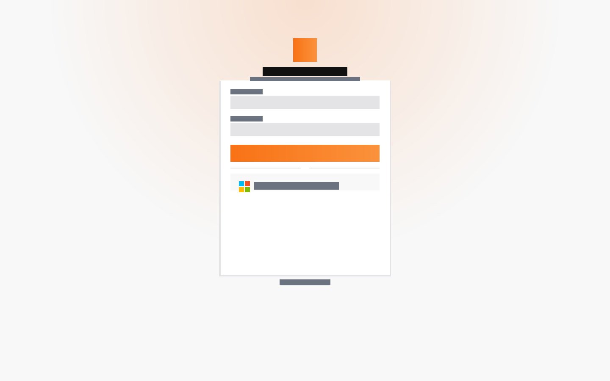
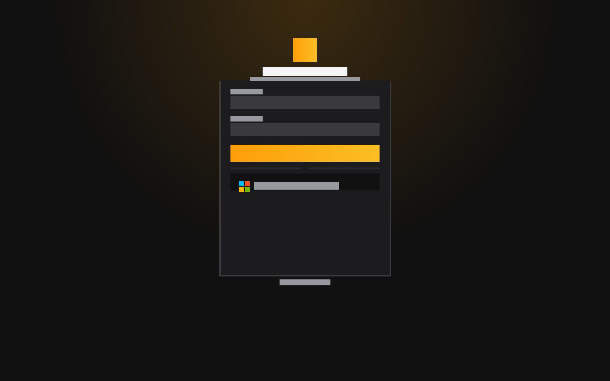
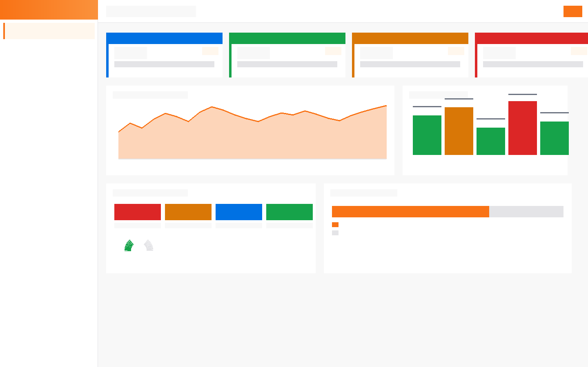
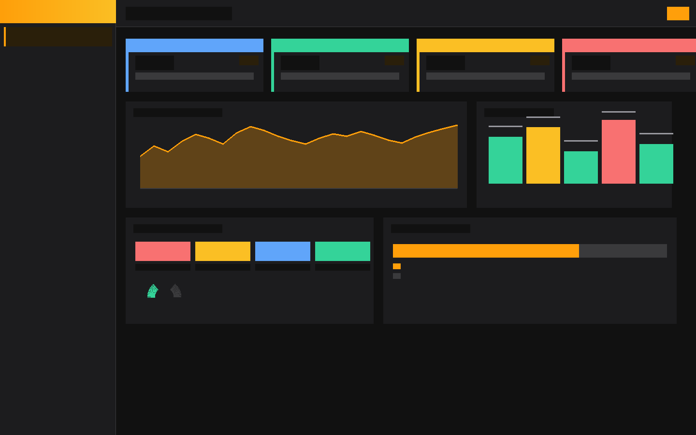

# CloudPulse Platform

A single-pane console for a Windows server estate and its Microsoft 365 tenant. Built because running Elasticsearch dashboards, Defender, Entra ID admin centre, and Jira side by side gets old fast.

The short version: it pulls server metrics from Elasticsearch, identity and security data from Microsoft Graph, alerts from a Teams monitoring chat, and tickets from Jira — then rolls all of it into one web UI with scheduled reports and a chat assistant that can query across all of it.

## Screenshots

<table>
<tr>
<td align="center"><b>Login — light</b></td>
<td align="center"><b>Login — dark</b></td>
</tr>
<tr>
<td></td>
<td></td>
</tr>
<tr>
<td align="center"><b>Dashboard — light</b></td>
<td align="center"><b>Dashboard — dark</b></td>
</tr>
<tr>
<td></td>
<td></td>
</tr>
</table>

---

## What's inside

### Azure / Entra ID login

Sign-in goes through your Azure tenant. The app registers as a Confidential Client in Entra ID and exchanges an authorisation code for tokens via MSAL. On first login, an Entra object ID gets linked to the local account, so afterwards the user can sign in with their Microsoft credentials instead of a password stored in the app. The redirect URI, client ID and tenant ID are set once in Admin Settings; after that, users hit "Sign in with Microsoft" and land straight in the dashboard.

This means no separate password to manage for most staff, and revoking access at the Entra level (disabling the account or ending the session) takes effect at next token refresh.

### Capacity and resource forecasting

Every hour the app pulls per-server CPU, memory and disk snapshots from Elasticsearch. A nightly job aggregates those into daily rows, then fits a linear model to each metric per server:

- CPU: `vCPU used = server vCPU count × daily average CPU %` (vCPU from the server inventory, so you get absolute core counts, not just percentages)
- Memory: used GB vs. total GB
- Disk: used GB vs. total GB, per host

From those slopes it calculates when each server hits 90% and when it runs full, at 30 / 90 / 180 / 365-day horizons. Confidence is rated low / medium / high based on how much history the regression covers and the R² fit. Servers with fewer than 14 days of data are flagged low-confidence and excluded from the risk matrix until they have enough history.

The fleet view rolls single-server forecasts up by project, so you can see which project's storage will hit 90% first. Servers that are already over threshold or trending there within 30 days get a critical flag; those within 90 days get a warning.

### LLM-backed assistant and alert analysis

The assistant uses any OpenAI-compatible chat completions endpoint (we run a local Qwen model). It has read-only tools over:

- Server inventory and current metrics
- Capacity forecasts and risk matrix
- Entra ID accounts, MFA status, licences
- Defender incidents and alerts
- Teams alert history

Ask it "which servers are likely to run out of disk before end of quarter" or "show me accounts with no MFA and active licences" and it will query the relevant data and return a table. It won't invent numbers — the tools return live data, not summaries.

The Teams alert parser also uses the LLM. When a new alert lands in the monitoring chat, the service calls the model to extract the hostname, metric and threshold, classify severity, and draft a Jira ticket description. That draft goes into the alert card in the UI; an engineer reviews and fires it to Jira from there.

Reports include a capacity narrative section — the LLM reads the risk matrix and writes a two-paragraph plain-English summary that goes into the emailed HTML report.

### Microsoft Defender and security posture

Data comes from Microsoft Graph using Application permissions (the app never writes to the tenant):

- **Secure Score** — current score, trend over the past 30 days, and the full improvement action list with category, max points and current state
- **Defender XDR incidents and alerts** — 30-day window, severity, assigned status, evidence (devices and users named in each incident)
- **Identity Protection** — risky users, risk level and the detections that triggered the flag (leaked credentials, atypical travel, etc.)
- **Intune device compliance** — managed devices, compliance policy status, last check-in, OS version
- **Defender device inventory** via advanced hunting KQL — vulnerabilities by CVE (CVSS score, patch availability, exposure level), missing security updates by KB, antivirus mode and definition age, end-of-support software, and a per-device secure configuration assessment across 30+ configuration checks

The app runs these as a single collection pass every `ad.refresh_minutes` (default 60). Each section writes independently to a JSONB snapshot table, so a Graph call that times out doesn't blank everything else.

### Entra ID identity health

Same collection run as security, separate service. It monitors:

- **MFA registration gap** — compares the number of users with MFA registered against the `ad.mfa_target_pct` target (default 95%). Separate counts for users under a Conditional Access MFA *requirement* vs. those who have it *registered*, because the two don't always match.
- **Privileged roles** — all current role assignments with a configurable warning threshold on Global Administrators (default 5). Flags roles assigned directly (not through PIM) and permanent assignments that should be eligible-only.
- **Stale accounts** — sign-in activity from the last 90 days; accounts inactive beyond a configurable threshold get flagged.
- **Failed sign-ins** — aggregate count over a rolling window (default 24 hours) against a fleet threshold, plus per-account thresholds so a single account with an unusual spike shows up separately from background noise.
- **App registrations and secrets** — expiry dates for all client secrets and certificates across all app registrations, with 30/14/7-day warnings.
- **Licence utilisation** — assigned vs. purchased for each paid SKU, warning when an SKU is at or near full assignment.
- **Audit log** — directory changes from the last 7 days: user creation, deletion, role assignment changes, credential resets.

An overall health score (0–100) is derived from open findings weighted by severity. Domain controllers report their own metrics (replication lag, DNS, FSMO, SYSVOL) through a lightweight on-prem component.

### Teams alert pipeline

A background job polls a designated Teams chat every 15 seconds using the Graph API. Incoming messages go through a pattern matcher that extracts hostname, metric type (CPU, memory, disk, service, custom), threshold and current value. Repeated alerts for the same host and metric within a configurable window get grouped rather than creating a new card each time.

The job also polls for recovery. When the same host's metric comes back below threshold — or the source system posts a resolved message — the alert card closes automatically. Everything stays in the UI for audit; resolved cards just move to the history tab.

### Reports

Four report types, each producing a branded HTML email with a CSV attachment:

| Report | Contents |
|---|---|
| Fleet capacity | Per-server current utilisation + 90-day and 1-year forecasts, risk matrix, LLM narrative summary |
| Operations | Alert history, ticket counts by status, service health |
| Security | Secure Score trend, open incidents, risky users, device compliance summary, CVE counts |
| Identity | MFA gap, privileged roles, stale accounts, upcoming credential expiries, licence headroom |

Run on demand from the UI or on a schedule (cron-style expressions in Admin Settings). The schedule runs on a 60-second tick with PostgreSQL advisory locks so only one worker sends per period even with multiple uvicorn workers running.

---

## Architecture

```
            browser
               │  HTTPS
          ┌────▼─────┐
          │  nginx   │
          └────┬─────┘
               │  127.0.0.1:8694
     ┌─────────▼──────────┐
     │     FastAPI app     │ ──▶ Elasticsearch    (server metrics)
     │  (uvicorn, 2 wkrs)  │ ──▶ Microsoft Graph  (Entra ID, Defender, Intune, Teams)
     └─────────┬──────────┘ ──▶ Jira, SMTP, LLM
               │  5432
          ┌────▼─────┐
          │ PostgreSQL│
          └──────────┘
```

APScheduler runs inside the app process. Background jobs that should not run twice take PostgreSQL advisory locks:

| Job | Default schedule |
|---|---|
| Elasticsearch metric collection | hourly at :05 |
| Daily capacity aggregation + forecast | 01:00 daily |
| Teams polling + alert clearing | every 15 s |
| Graph collection (identity + security) | every 60 s tick, collects every `ad.refresh_minutes` |
| Report dispatch | every 60 s tick |

More detail in [docs/architecture.md](docs/architecture.md).

---

## Repository layout

```
app/
  main.py               app factory, scheduler, startup
  routers/              REST endpoints (/api/...)
  services/             all integrations and business logic
    ad_service.py       Entra ID identity collection
    security_service.py Defender, Secure Score, Intune, risky users
    capacity_forecast.py absolute-unit forecasting (vCPU / GB)
    prediction_service.py linear regression core
    teams_alert_service.py Teams polling + alert lifecycle
    assistant_service.py  LLM tool-calling interface
    llm_service.py        OpenAI-compatible completions client
static/
  app.html              single-page front end
  login.html            sign-in page (local + Microsoft button)
  ds.css                design tokens
  brand/
scripts/
  check_connectivity.py pre-flight Graph + ES check
db/
  Containerfile         PostgreSQL 16 with schema initialisation
  init/
deploy/
  quadlet/              systemd Quadlet units
  nginx/                reverse proxy config
docs/
Containerfile
.env.example
```

---

## Requirements

- Podman 4.4 or later with Quadlet (rootless works fine)
- Elasticsearch 7+ reachable from the app container
- An Entra ID **app registration** with Application permissions (see [docs/graph-permissions.md](docs/graph-permissions.md))
- For Entra login: the registration needs a redirect URI and a client secret
- nginx or equivalent for TLS termination
- An OpenAI-compatible LLM endpoint if you want the assistant and alert analysis (optional — the rest of the app works without it)

---

## Quick start

```bash
git clone https://github.com/nanosof/CloudPulseOPS.git cloudpulse-platform
cd cloudpulse-platform

# Build images
podman build -t localhost/cloudpulse:latest .
podman build -t localhost/cloudpulse-db:latest db/

# Set up environment files
mkdir -p ~/.config/cloudpulse
cp .env.example      ~/.config/cloudpulse/cloudpulse.env
cp db/db.env.example ~/.config/cloudpulse/db.env
chmod 600 ~/.config/cloudpulse/*.env
# Edit both files — minimum: DATABASE_URL password and JWT_SECRET (openssl rand -hex 32)

# Install Quadlet units and start
cp deploy/quadlet/cloudpulse.network deploy/quadlet/cloudpulse-db.container \
   deploy/quadlet/cloudpulse.container ~/.config/containers/systemd/
systemctl --user daemon-reload
systemctl --user start cloudpulse-db.service cloudpulse.service

# Check
curl -s http://127.0.0.1:8694/health
```

First start creates the database, applies the schema, and sets the `admin` account to the password in `CLOUDPULSE_ADMIN_PASSWORD`. Change it under **Admin → Users** before doing anything else, then fill in the integrations under **Admin → Settings**.

For rootless Podman on a shared host: `loginctl enable-linger <user>` keeps services running after logout.

On hosts where OS package mirrors are unreachable, the incremental Containerfile skips the `apt` layer:

```bash
podman build -f Containerfile.update \
  --build-arg BASE=localhost/cloudpulse:<current-tag> \
  -t localhost/cloudpulse:<new-tag> .
podman tag localhost/cloudpulse:<new-tag> localhost/cloudpulse:latest
systemctl --user restart cloudpulse.service
```

---

## Configuration

`DATABASE_URL` and `JWT_SECRET` are the only environment variables. Everything else lives in the database and is editable in Admin Settings without a restart.

| Integration | Keys to set |
|---|---|
| Elasticsearch | `es.url`, `es.username`, `es.password`, `es.index_pattern` |
| Microsoft Graph (identity + security) | `entra.tenant_id`, `entra.client_id`, `entra.client_secret` |
| Entra ID login (SSO) | same three above, plus `entra.redirect_uri` |
| Teams alerts | `teams.chat_id`, `teams.enabled = true` |
| Jira | `jira.base_url`, `jira.username`, `jira.api_token`, `jira.project_key` |
| Mail | `mail.host`, `mail.port`, `mail.from` |
| LLM / assistant | `llm.base_url`, `llm.model`, `llm.api_key` |

Full reference in [docs/configuration.md](docs/configuration.md).

### Agent API

External tools (n8n, Zabbix webhooks, etc.) can query live server data at `/api/v1/agent/...` with an `X-CloudPulse-Key` header. The key and optional IP allowlist are under `agent.*` in Settings.

---

## Entra ID app registration

The Graph integration needs Application (not Delegated) permissions so it can collect data without a signed-in user. Minimum set for full functionality:

```
Directory.Read.All
User.Read.All
AuditLog.Read.All
Reports.Read.All
Organization.Read.All
SecurityEvents.Read.All
SecurityIncident.Read.All
SecurityAlert.Read.All
IdentityRiskyUser.Read.All
IdentityRiskEvent.Read.All
ServiceHealth.Read.All
ServiceMessage.Read.All
DeviceManagementManagedDevices.Read.All
DeviceManagementConfiguration.Read.All
DeviceManagementApps.Read.All
ThreatHunting.Read.All
ChannelMessage.Read.All
```

For Entra login, the same registration also needs the Delegated `openid`, `profile` and `email` permissions, with a redirect URI matching `entra.redirect_uri` in Settings. See [docs/graph-permissions.md](docs/graph-permissions.md) for the full setup walkthrough.

---

## Upgrading

```bash
git pull
podman build -t localhost/cloudpulse:latest .
systemctl --user restart cloudpulse.service
```

Schema changes are additive — missing tables and columns are created on startup. Back up the database first:

```bash
pg_dump -Fc cloudpulse > cloudpulse-$(date +%Y%m%d-%H%M).dump
```

See [docs/operations.md](docs/operations.md) for restore procedures and troubleshooting.

---

## Security notes

- `cloudpulse.env` and `db.env` contain credentials. Keep them `chmod 600` and out of version control (`.gitignore` covers `*.env` already).
- Secret settings written to the database are never returned to the browser.
- The Graph app registration has read-only permissions. The app makes no write calls to the tenant.
- The assistant's tools are read-only. It cannot modify inventory, settings or alerts.
- Entra login tokens are validated server-side on every request; the browser holds only a short-lived JWT signed with `JWT_SECRET`.

---

## Docs

- [Architecture](docs/architecture.md)
- [Configuration reference](docs/configuration.md)
- [Microsoft Graph permissions](docs/graph-permissions.md)
- [Operations guide](docs/operations.md)
